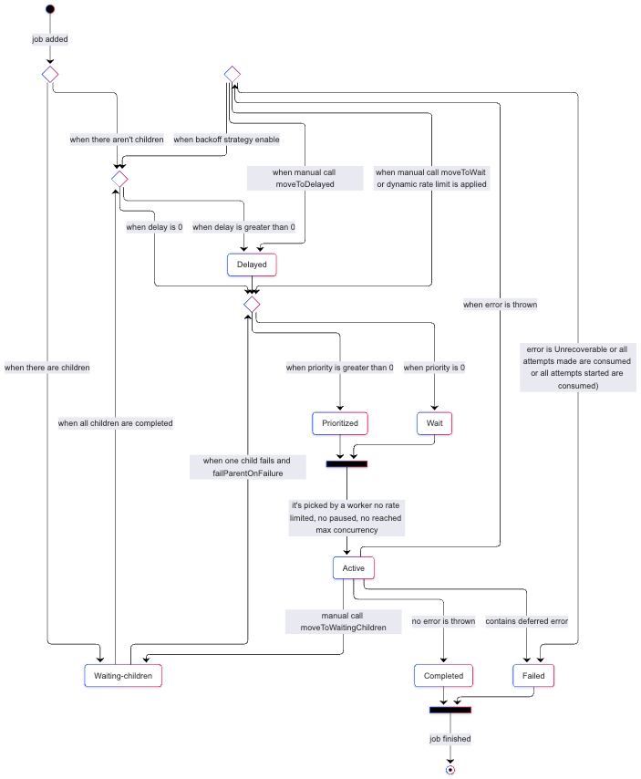

# Architecture

In order to use the full potential of BullMQ queues, it is important to understand the lifecycle of a job. From the moment a producer calls the [`add`](https://docs.bullmq.io/api/classes/v6.Queue.html#add) method on a `Queue` instance, a job enters a lifecycle where it will be in different states, until its completion or failure (although technically a failed job could be retried and get a new lifecycle).

<figure><figcaption>
Lifecycle of a job - Queue
</figcaption></figure>

When a job is added to a queue it can be in one of three states:

- **“wait”**: a waiting list, where all jobs must enter before they can be processed.
- **“prioritized”**: implies that a job with higher priority will be processed first.
- **“delayed”**: implies that the job is waiting for some timeout or to be promoted for being processed. These jobs are not processed directly, but instead are placed at the beginning of the waiting list, or in a prioritized set, and processed as soon as a worker is idle.


Note that prioritized jobs use values from `1` to `2^21 - 1` (2 097 151), where a lower number is always a higher priority than higher numbers. This follows a similar standard as in Unix processes (https://en.wikipedia.org/wiki/Nice_(Unix)), where a higher number means less priority. A `priority` of `0` means no explicit priority is set, but since those jobs are always processed before any prioritized job, you can effectively think of `0` as the highest priority of all.


The next state for a job is the **“active”** state. The active state is represented by a set, and are jobs that are currently being processed (i.e. they are running in the `process` function explained in the previous chapter). A job can be in the active state for an unlimited amount of time until the process is completed or an exception is thrown so that the job will end in either the **“completed”** or the **“failed”** status.

Another way to add a job is by the [`add`](https://docs.bullmq.io/api/classes/v6.FlowProducer.html#add) method on a flow producer instance.

<figure><figcaption>
Lifecycle of a job - Flow Producer
</figcaption></figure>

When a job is added by a flow producer, it can be in one of three states, it can either be in the **“wait”** or **“prioritized“** or **“delayed“** status, when there aren't children, or it can be in a **“waiting-children”** status: a waiting-children status implies that the job is waiting for all its children to be completed, however, a waiting-children job will not be processed directly, instead it will be placed at the waiting list or at delayed set (if `delay` is provided) or at prioritized set (if `delay` is 0 and `priority` is greater than 0) as soon as the last child is marked as completed.

## Backends

The lifecycle described above is the same regardless of where the jobs are stored. BullMQ is built in layers:

1. **High-level classes** (`Queue`, `Worker`, `QueueEvents`, `FlowProducer`, …) implement the public API. They are datastore agnostic and only depend on the backend contract ([`IQueueBackend`](https://docs.bullmq.io/api)).
2. **Backends** implement every queue operation, such as adding a job, moving it to active, extending its lock or blocking until a new job is available, and perform each state transition atomically:
   - The **Redis™ backend** (default) implements every operation as a Lua script, so each state transition runs atomically inside Redis. Workers block on a marker key, so they are notified immediately when a job is available without polling. It works with any of the supported Redis clients and with compatible servers such as Valkey and Dragonfly.
   - The **PostgreSQL backend** stores jobs in regular tables and implements every operation as a SQL function running in a transaction. Workers block on a dedicated `LISTEN` connection and are woken up by producers using `NOTIFY`. See [PostgreSQL backend](postgresql.md#how-it-works) for more details.
3. **Datastore clients** handle the connections, such as ioredis, node-redis, Bun's Redis client or Valkey GLIDE for Redis, and node-postgres for PostgreSQL. See [Connections](connections.md).

The Lua and SQL scripts are shared by all the BullMQ SDKs (TypeScript, Python, Elixir, Rust, .NET and PHP), which are thin layers on top of them. This is what guarantees identical semantics across languages, and what makes it possible to add jobs from one language and process them from another, as long as they use the same backend.
