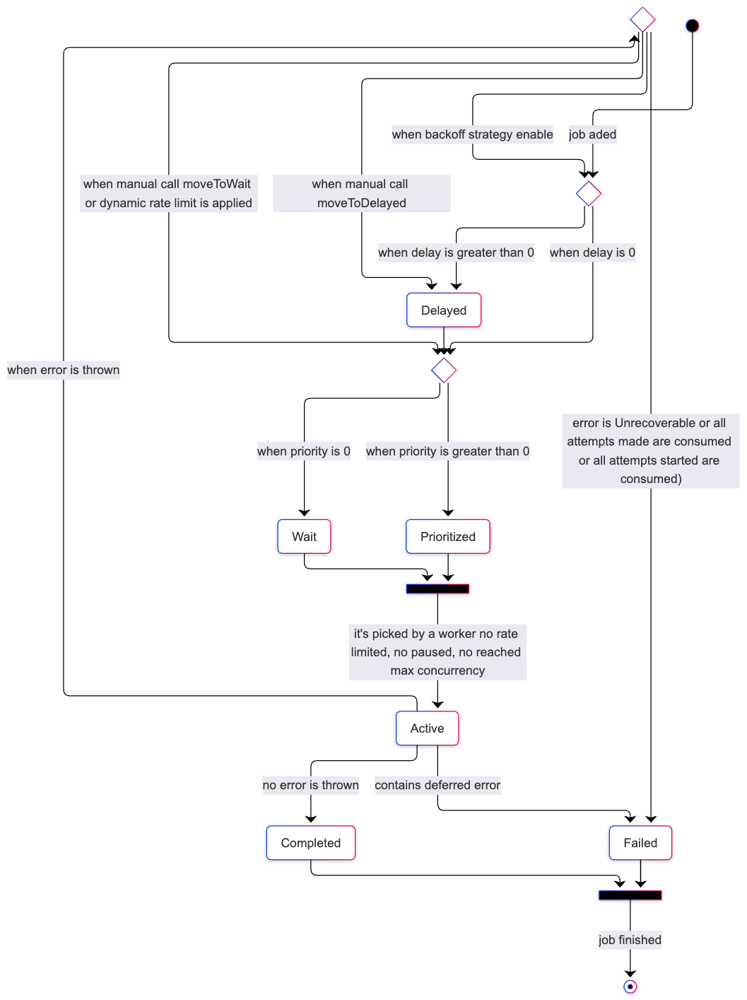

# Getters

When jobs are added to a queue, they will be in different statuses during their lifetime. BullMQ provides methods to retrieve information and jobs from the different statuses.

<figure><figcaption><p>Lifecycle of a job</p></figcaption></figure>

#### Job Counts

It is often necessary to know how many jobs are in a given status:




```typescript
import { Queue } from 'bullmq';

const myQueue = new Queue('Paint');

const counts = await myQueue.getJobCounts('wait', 'completed', 'failed');

// Returns an object like this { wait: number, completed: number, failed: number }
```





```python
from bullmq import Queue

myQueue = Queue('Paint')

counts = await myQueue.getJobCounts('wait', 'completed', 'failed')

# Returns an object like this { wait: number, completed: number, failed: number }
```





```elixir
{:ok, counts} =
  BullMQ.Queue.get_job_counts("Paint", [:waiting, :completed, :failed], connection: :my_redis)

# Returns a map like this %{waiting: number, completed: number, failed: number}
```





```csharp
using BullMQ;

await using var myQueue = new Queue("Paint", new QueueOptions
{
    Connection = ConnectionOptions.FromString("localhost:6379"),
});

var counts = await myQueue.GetJobCountsAsync("wait", "completed", "failed");

// Returns a dictionary like this { wait: number, completed: number, failed: number }
```





```rust
use bullmq::Queue;

let queue = Queue::new("Paint").await?;

let counts = queue.get_job_counts().await?;
// counts.waiting, counts.completed, counts.failed, counts.active, etc.
println!("waiting: {}, completed: {}, failed: {}", counts.waiting, counts.completed, counts.failed);
```





```php
<?php

use BullMQ\Queue;

$myQueue = new Queue('Paint');

$counts = $myQueue->getJobCounts();

// Returns an array with the count of every status, like this
// ['waiting' => int, 'active' => int, 'completed' => int, 'failed' => int, ...]
```




The available status are:

- _completed_,
- _failed_,
- _delayed_,
- _active_,
- _wait_,
- _waiting-children_,
- _prioritized_,
- _paused_, and
- _repeat_.

#### Count overdue delayed jobs (TypeScript)

Pass a Unix timestamp in milliseconds to `getDelayedCount` to count delayed
jobs scheduled strictly before that time:

```typescript
const overdue = await myQueue.getDelayedCount(Date.now());
const allDelayed = await myQueue.getDelayedCount();
```

Jobs scheduled exactly at the cutoff are excluded. Calling the method without
an argument still counts all delayed jobs, including those scheduled for the
future. This count only includes jobs still in delayed status; jobs already
promoted to waiting or active are not included.

#### Get Jobs

It is also possible to retrieve the jobs with pagination style semantics. For example:




```typescript
const completed = await myQueue.getJobs(['completed'], 0, 99, true);

// returns jobs at indices 0-99 inclusive (100 jobs total)
```





```python
completed = await myQueue.getJobs(['completed'], 0, 99, True)

# returns jobs at indices 0-99 inclusive (100 jobs total)
```





```elixir
{:ok, completed} =
  BullMQ.Queue.get_jobs("Paint", [:completed], connection: :my_redis, start: 0, end: 99, asc: true)

# returns jobs at indices 0-99 inclusive (100 jobs total)
```





```csharp
var completed = await myQueue.GetJobsAsync(new[] { "completed" }, 0, 99, true);

// returns jobs at indices 0-99 inclusive (100 jobs total)
```





```rust
let completed = queue.get_jobs(&["completed"], 0, 99, true).await?;

// returns jobs at indices 0-99 inclusive (100 jobs total)
```





```php
$completed = $myQueue->getJobsByType(['completed'], 0, 99, true);

// returns jobs at indices 0-99 inclusive (100 jobs total)
```




#### Waiting jobs and delayed backlogs

`getWaiting()` and `getWaitingCount()` do not include jobs that are still in
delayed status, even when their scheduled time has passed. If workers cannot
process jobs fast enough, a large backlog of overdue delayed jobs can accumulate.
A small waiting count therefore does not necessarily mean there is little work
left to process.

In TypeScript, monitor both the waiting count and the overdue delayed count:

```typescript
const waiting = await myQueue.getWaitingCount();
const overdueDelayed = await myQueue.getDelayedCount(Date.now());
```

`getWaiting()` only retrieves jobs in waiting status. To inspect jobs that are
still delayed, use `getJobs(['delayed'], start, end)`.

## Read more:

- 💡 [Get Job Counts API Reference](https://docs.bullmq.io/api/classes/v6.Queue.html#getjobcounts)
- 💡 [Get Jobs API Reference](https://docs.bullmq.io/api/classes/v6.Queue.html#getjobs)
